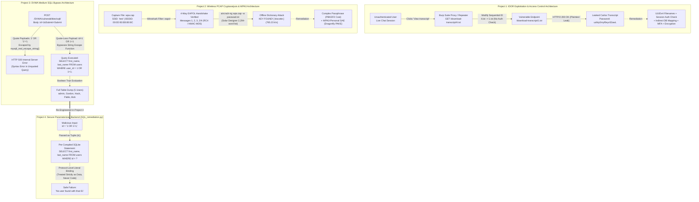

# VA Initiatives Ethical Hacking Project: Web App Pentesting, Wireless Cryptanalysis & Secure Backend Engineering


> **Executive Summary:** This four-part offensive and defensive security capstone project demonstrates end-to-end vulnerability identification, exploitation, wireless traffic cryptanalysis, and secure code remediation. Across four distinct engagements, this project exploits an **Insecure Direct Object Reference (IDOR)** flaw in a live chat transcript endpoint using Burp Suite to uncover leaked credentials, analyzes an IEEE 802.11 **PCAP capture (`wpa.cap`)** in Wireshark and cracks its WPA 4-way handshake via an offline dictionary attack in Aircrack-ng, bypasses `mysqli_real_escape_string()` in **Damn Vulnerable Web Application (DVWA)** at the Medium security level using quote-less **SQL Injection (`1 OR 1=1`)**, and re-engineers the vulnerable PHP database layer into a hardened **Python (`sqlite3`) parameterized backend (`SQL_remediation.py`)** that neutralizes injection payloads at the protocol level.

| Field | Detail |
| :--- | :--- |
| **Programme** | The Victor Akinode (VA) Initiatives — Cybersecurity Mentorship Programme |
| **Security Researcher** | Chinaza Nnamani |
| **Project Scope** | 4-Part Ethical Hacking, Network Cryptanalysis & Secure Software Engineering Capstone |
| **Primary Environment** | Kali Linux (Oracle VirtualBox), Burp Suite Professional `v2024.5`, Wireshark, Aircrack-ng `1.7`, DVWA, Python 3 |
| **Completion Date** | February 19, 2026 |

---

## Table of Contents
- [Tools Used](#tools-used)
- [Skills Learned](#skills-learned)
- [1. Problem Statement & Objectives](#1-problem-statement--objectives)
- [2. Architecture & Design Overview](#2-architecture--design-overview)
- [3. Technology Stack & Tooling](#3-technology-stack--tooling)
- [4. Full Documentation Index](#4-full-documentation-index)
- [5. Implementation Walkthrough](#5-implementation-walkthrough)
  - [Project 1: Insecure Direct Object References (IDOR)](#project-1-insecure-direct-object-references-idor)
  - [Project 2: PCAP File Analysis & WPA Handshake Recovery](#project-2-pcap-file-analysis--wpa-handshake-recovery)
  - [Project 3: SQL Injection (SQLi) at Medium Security Level (DVWA)](#project-3-sql-injection-sqli-at-medium-security-level-dvwa)
  - [Project 4: Building a Secure Login / User Lookup Module](#project-4-building-a-secure-login--user-lookup-module)
- [6. Validation, Testing & Proof of Work](#6-validation-testing--proof-of-work)
- [7. Key Challenges & Trade-Offs](#7-key-challenges--trade-offs)
- [8. Future Enhancements](#8-future-enhancements)
- [Author & Contact](#author--contact)

---

## Tools Used

**Operating Systems & Vulnerable Lab Platforms**  


-8892BF?style=for-the-badge&logo=php&logoColor=white)


**Web Pentesting & Wireless Cryptanalysis**  


**Application, Scripting & Databases**  

-003B57?style=for-the-badge&logo=sqlite&logoColor=white)


---

## Skills Learned

**Offensive Security & Cryptanalysis**  
-Offensive_Security-critical?style=flat-square)


**Secure Engineering & Governance**  


---

## 1. Problem Statement & Objectives

### Background & Risk / Bottleneck
Modern enterprise environments face converging threats across web applications, wireless networks, and backend database layers. Common engineering anti-patterns—such as exposing sequential file identifiers (`/download-transcript/4.txt`) without session authorization checks, relying on weak pre-shared keys over WPA/WPA2 4-way handshakes, applying string-escaping functions (`mysqli_real_escape_string`) to unquoted numeric SQL inputs (`WHERE user_id = $id`), and concatenating user input directly into SQL queries—create high-severity attack vectors that lead to credential theft, unauthorized data disclosure, and compliance violations under **GDPR** and **SOC 2**.

### Core Objectives
This project is divided into four distinct modules with specific offensive and defensive objectives:
* **Project 1 — Insecure Direct Object References (IDOR):** Identify and exploit a broken access control vulnerability in an online retail web application's "Live Chat" transcript download feature, extract sensitive user credentials (`carlos`), assess business/compliance impact, and design an enterprise remediation plan.
* **Project 2 — PCAP File Analysis (`wpa.cap`):** Inspect raw IEEE 802.11 wireless traffic in Wireshark to confirm the presence of a 4-way EAPOL handshake, execute an offline dictionary attack using Aircrack-ng to recover the Wi-Fi passphrase (`biscotte`), and evaluate cryptographic mitigations using high-entropy passphrases and WPA3 (SAE / Dragonfly Handshake).
* **Project 3 — SQL Injection (SQLi) at Medium Security Level (DVWA):** Analyze the backend PHP source code difference between DVWA's `Low` and `Medium` security levels, bypass the `mysqli_real_escape_string()` defense on an unquoted integer parameter using a quote-less boolean payload (`1 OR 1=1`), dump the user table, and document input-handling and prepared-statement remediations.
* **Project 4 — Building a Secure Login / User Lookup Module (`SQL_remediation.py`):** Replace the vulnerable PHP database query logic with a production-ready Python backend using `sqlite3` parameterized queries (`?` placeholders) and validate that malicious inputs (`"1 OR 1=1;"`) safely fail without executing injected SQL commands.

> [!IMPORTANT]
> **Scope Note:** All architectural diagrams, offensive/defensive workflows, source code comparisons, and empirical validation proofs are consolidated directly inside this `README.md`. Dedicated environment setup instructions and troubleshooting runbooks are provided in [`setup.md`](./setup.md) and [`troubleshooting.md`](./troubleshooting.md).

---

## 2. Architecture & Design Overview

### System Workflow Across All 4 Projects (Mermaid Diagram)



### Key Architectural & Security Design Decisions
1. **Eliminating Predictable Direct Object References (Project 1):** Replacing sequential filenames (`1.txt`, `2.txt`, `3.txt`, `4.txt`) exposed in `/download-transcript/` with unguessable **UUIDv4** identifiers, indirect database reference mappings, and server-side session ownership validation ensures that resources cannot be enumerated or retrieved by unauthenticated or unauthorized users.
2. **Transitioning from WPA2-PSK 4-Way Handshakes to WPA3-SAE (Project 2):** Because WPA/WPA2-Personal transmits enough plaintext parameters (ANonce, SNonce, MACs, MIC) during the 4-way EAPOL handshake to permit unlimited offline dictionary attacks against weak passphrases (`biscotte`), upgrading to **WPA3 Simultaneous Authentication of Equals (SAE / Dragonfly Handshake)** enforces a Password-Authenticated Key Exchange (PAKE) that prevents offline hash/MIC cracking and introduces router-level rate limiting.
3. **Why String Escaping Fails on Unquoted Numeric SQL Contexts (Project 3):** DVWA's Medium level applies `mysqli_real_escape_string()` to `$_POST['id']` but interpolates `$id` directly into `WHERE user_id = $id;` without surrounding single quotes. Because `mysqli_real_escape_string()` only escapes special string characters (`'`, `"`, `\`), an attacker can inject `1 OR 1=1` without using quotes, proving that manual escaping is an incomplete defense.
4. **Enforcing Protocol-Level Separation of Code and Data (Project 4):** In `SQL_remediation.py`, replacing string concatenation with parameterized queries (`WHERE id = ?` and `cursor.execute(query, (id,))`) forces the SQLite database driver to compile the SQL abstract syntax tree (AST) before binding the user parameter as a literal value, neutralizing `1 OR 1=1;` completely.

---

## 3. Technology Stack & Tooling

| Category | Tool / Platform | Role in This Project | Why It Was Chosen |
| :--- | :--- | :--- | :--- |
| **Attack Workstation** | Kali Linux (Oracle VirtualBox) | Primary offensive security and development OS | Pre-packaged with Burp Suite, Wireshark, Aircrack-ng, Apache/MySQL, and Python 3 |
| **Web Proxy & Repeater** | Burp Suite Professional `v2024.5` | Intercepting and manipulating HTTP/1.1 & HTTP/2 requests in Projects 1 & 3 | Industry-standard web proxy for testing IDOR parameter tampering and SQLi payloads |
| **Target Web Labs** | PortSwigger Academy & DVWA | Hosting the vulnerable Live Chat IDOR app (Project 1) and Medium SQLi lab (Project 3) | Provides realistic, isolated web vulnerability benchmarks with inspectable source code |
| **Packet Analyzer** | Wireshark | Inspecting IEEE 802.11 frames and filtering `eapol` 4-way handshakes in `wpa.cap` (Project 2) | Deep protocol dissection down to 802.1X Authentication and EAPOL WPA Key descriptors |
| **Wireless Auditing** | Aircrack-ng `v1.7` & `password.lst` | Verifying WPA handshake presence and running offline dictionary attacks (Project 2) | High-speed multi-threaded PMK/MIC calculation (`765.23 k/s`) against captured PCAP files |
| **Secure Backend** | Python 3 & `sqlite3` | Implementing the remediated parameterized database module (`SQL_remediation.py` in Project 4) | Built-in DB-API 2.0 parameter substitution (`?`) demonstrating strict separation of code and data |

---

## 4. Full Documentation Index

For environment configuration, dependency installation, and operational troubleshooting, consult the companion guides in this repository:

```text
VA-Mentorship-project/
├── assets/
│   ├── images/                                                 # All 22 step-by-step screenshots extracted from the report
│   └── CHINAZA_NNAMANI_VA_INITIATIVES_ETHICAL_HACKING_PROJECT.pdf  # Original 20-page PDF Capstone Documentation
├── SQL_remediation.py                                          # Hardened Python SQLite3 parameterized query module (Project 4)
├── setup.md                                                    # Complete lab setup & reproduction guide for Projects 1–4
├── troubleshooting.md                                          # Operational runbook & failure-mode resolution guide
└── README.md                                                   # Main technical case study & architectural documentation
```

| Document | Description |
| :--- | :--- |
| [**`README.md`**](./README.md) | Complete 4-part case study, architectural diagrams, exploitation walkthroughs, and remediation plans. |
| [**`setup.md`**](./setup.md) | Step-by-step installation, lab initialization, wordlist acquisition, and test database setup for all 4 projects. |
| [**`troubleshooting.md`**](./troubleshooting.md) | Diagnostic runbook covering Burp Suite HTTP/2 handling, Aircrack-ng dictionary errors, DVWA HTTP 500 errors, and Python tuple binding. |
| [**`SQL_remediation.py`**](./SQL_remediation.py) | Production-ready Python module using parameterized SQLite queries to prevent SQL injection. |

---

## 5. Implementation Walkthrough

### Project 1: Insecure Direct Object References (IDOR)

#### 1. Lab Setup & Reconnaissance
* **Target URL:** `https://0aaa00cc04df2f8e83d138b2006600ee.web-security-academy.net/`
* **Authentication Status:** Logged out (Unauthenticated).
* **Application Overview:** The target web application is an online retail store ("WE LIKE TO SHOP") featuring a **Home** page where products are listed with prices and ratings, a **My account** page where users can log in and view their account details, and a **Live chat** feature where users can chat with customer support ("Hal Pline") in real time.


*Figure 1: Target online retail store home page (`https://0aaa00cc04df2f8e83d138b2006600ee.web-security-academy.net/`) accessed in an unauthenticated state.*


*Figure 2: The "My account" Login page requiring a valid Username and Password.*

#### 2. Initial Observed Behavior
During initial reconnaissance of the web application, the following behaviors were observed:
* The web application allows an unauthenticated user to browse listed products and view their details.
* An unauthenticated user is permitted to use the **Live chat** feature anonymously.
* The **Live chat** page includes a **View transcript** button that downloads the chat history transcript as a plain-text file (`.txt`).
* Each downloaded transcript is named and stored serially (`3.txt`, `4.txt`, etc.).


*Figure 3: Interacting with the "Live chat" feature and observing sequential plain-text transcript filenames (`3.txt` and `4.txt`) in the browser downloads manager.*

#### 3. Identifying the Vulnerability
While still unauthenticated, we captured the HTTP request triggered by clicking **View transcript** using **Burp Suite Professional v2024.5**:
* The captured `GET /download-transcript/4.txt HTTP/2` request reveals that chat transcripts are served directly from the `/download-transcript/` directory on the server.
* Given the sequential integer naming convention (`3.txt`, `4.txt`), earlier chat transcripts created by other users (such as `1.txt` and `2.txt`) are likely stored in the same directory.


*Figure 4: Capturing the `GET /download-transcript/4.txt HTTP/2` request and inspecting the `HTTP/2 200 OK` plain-text attachment response in Burp Suite Repeater.*

**What the Application is Doing Incorrectly:**
1. **Sequential Filenames:** The application uses predictable, incremental integer naming (`1.txt`, `2.txt`, `3.txt`, `4.txt`) to store chat transcripts.
2. **Direct Access Without Authorization:** The application serves files directly from `/download-transcript/` without verifying session ownership or user authorization.
3. **Plain-Text Logs:** Sensitive chat transcripts containing user support conversations are stored and transmitted as unencrypted plain text.

#### 4. Exploiting the Flaw (Proof of Concept)
In **Burp Suite Repeater**, we modified the object reference in the request path from `/download-transcript/4.txt` to `/download-transcript/1.txt` and sent the request:

<details>
<summary><strong>Click to expand: Modified HTTP/2 Request & Leaked Transcript Response</strong></summary>

```http
GET /download-transcript/1.txt HTTP/2
Host: 0aaa00cc04df2f8e83d138b2006600ee.web-security-academy.net
Cookie: session=z1Oyi5umcUdbOl63g9zvrOi7iUL6yR
User-Agent: Mozilla/5.0 (X11; Linux x86_64; rv:140.0) Gecko/20100101 Firefox/140.0
Accept: text/html,application/xhtml+xml,application/xml;q=0.9,*/*;q=0.8
Accept-Language: en-US,en;q=0.5
Accept-Encoding: gzip, deflate, br
Referer: [https://0aaa00cc04df2f8e83d138b2006600ee.web-security-academy.net/chat](https://0aaa00cc04df2f8e83d138b2006600ee.web-security-academy.net/chat)
Upgrade-Insecure-Requests: 1
```

```http
HTTP/2 200 OK
Content-Type: text/plain; charset=utf-8
Content-Disposition: attachment; filename="1.txt"
X-Frame-Options: SAMEORIGIN
Content-Length: 555

CONNECTED: -- Now chatting with Hal Pline --
You: Hi Hal, I think I've forgotten my password and need confirmation that I've got the right one.
Hal Pline: Sure, no problem, you seem like a nice guy. Just tell me your password and I'll confirm whether it's correct or not.
You: Wow you're so nice, thanks. I've heard from other people that you can be a right ****
Hal Pline: Takes one to know one.
You: Ok so my password is: uz6rp2rnyf0eyv52awL. Is that right?
Hal Pline: Yep it is!
You: Ok thanks, bye!
Hal Pline: Go one!
```

</details>


*Figure 5: Modifying the request to `GET /download-transcript/1.txt HTTP/2` in Burp Suite Repeater, exposing another user's private chat transcript and leaking the password `uz6rp2rnyf0eyv52awL`.*

#### 5. Vulnerability Confirmation, Impact Assessment & Remediation Plan
* **Why This Confirms the Vulnerability:** Changing the requested object from `4.txt` to `1.txt` (which belongs to another user and should be restricted) caused the server to return `HTTP/2 200 OK` with the private chat history of user **`carlos`** to an unauthenticated attacker.
* **Business & Compliance Impact:** The leaked transcript exposed `carlos`'s plaintext password (`uz6rp2rnyf0eyv52awL`), enabling full account takeover via the `/login` page. While only one user (`carlos`) was directly affected in this instance, the flaw violates user privacy and breaches regulatory frameworks including **GDPR (General Data Protection Regulation)** and **SOC 2 (System and Organization Controls)**.

| Issue Identified | Technical Fix / Remediation | Security Benefit |
| :--- | :--- | :--- |
| **Filename Predictability** | Use long, cryptographically random **UUIDs** (UUIDv4) instead of sequential numbers (`1.txt`, `2.txt`). | Makes transcript filenames practically impossible to guess or brute-force. |
| **Direct Access** | Validate the user's session cookie before serving the file, and use an **indirect reference map** (a database ID mapped to the underlying file). | Ensures only authenticated, authorized owners can access their specific resources. |
| **Plain-Text Logs** | Encrypt server chat logs at rest (`AES-256`) and in transit (`TLS 1.3`), and redact sensitive secrets from support transcripts. | Protects sensitive conversation data at rest and in transit. |
| **Single-Factor Authentication** | Enforce **Multi-Factor Authentication (MFA)** (Authenticator App, SMS, or Hardware Security Key) for new sessions or unrecognized devices. | Prevents account takeover even if a user's password is leaked in a chat transcript. |
| **IDOR Vulnerability** | Implement strict server-side **Authorization Checks** (Access Control Lists / RBAC) on every sensitive endpoint and replace incremental IDs with complex references. | Eliminates horizontal and vertical privilege escalation via direct object tampering. |

---

### Project 2: PCAP File Analysis & WPA Handshake Recovery

#### 1. Confirming WPA Handshake Traffic in `wpa.cap` (Wireshark)
We opened the wireless packet capture file (`wpa.cap`) in **Wireshark** to inspect the IEEE 802.11 traffic and confirm the presence of a complete 4-way WPA handshake:
* **Capture Overview (13 Packets Total):** Packet `1` is an IEEE 802.11 Beacon frame advertising `SSID="test"` from BSSID `00:0d:93:eb:b0:8c` (`Apple_eb:b0:8c`).
* **Isolating the 4-Way Handshake (`eapol` Filter):** Applying the display filter `eapol` in Wireshark isolated the four `802.1X Authentication` (`EAPOL WPA Key (254)`, `Key Descriptor Version: RC4 Cipher, HMAC-MD5`, `Key Type: Pairwise Key`) handshake messages exchanged between the Access Point (`Apple_eb:b0:8c` / `00:0d:93:eb:b0:8c`) and the Client (`Netgear_91:53:5d` / `00:09:5b:91:53:5d`):
  * **Frame 2 (`t = 0.068977s`):** `Apple_eb:b0:8c` -> `Netgear_91:53:5d` | `EAPOL` | `279 bytes — Key (Message 1 of 4)`
  * **Frame 4 (`t = 0.071788s`):** `Netgear_91:53:5d` -> `Apple_eb:b0:8c` | `EAPOL` | `303 bytes — Key (Message 2 of 4)`
  * **Frame 6 (`t = 0.074633s`):** `Apple_eb:b0:8c` -> `Netgear_91:53:5d` | `EAPOL` | `303 bytes — Key (Message 3 of 4)`
  * **Frame 8 (`t = 0.075765s`):** `Netgear_91:53:5d` -> `Apple_eb:b0:8c` | `EAPOL` | `279 bytes — Key (Message 2 of 4 / Final Confirmation)`


*Figure 6: Opening `wpa.cap` in Wireshark, showing the `SSID="test"` Beacon frame, 802.11 Acknowledgements, and EAPOL Key frames.*


*Figure 7: Applying the `eapol` display filter in Wireshark to confirm the 4-way WPA handshake between `Apple_eb:b0:8c` and `Netgear_91:53:5d`.*

#### 2. Step-by-Step Wi-Fi Password Recovery (`aircrack-ng`)
* **Recovered Wi-Fi Password:** **`biscotte`**


*Figure 8: Aircrack-ng v1.7 successfully cracking the WPA handshake in `wpa.cap` and returning `KEY FOUND! [ biscotte ]`.*

**Steps Taken to Recover the Password:**
1. **Verify Handshake via CLI:** Ran `aircrack-ng wpa.cap` in the Kali Linux terminal (`~/Downloads`) to confirm Aircrack-ng recognized the target network (`#1 BSSID: 00:0D:93:EB:B0:8C`, `ESSID: test`, `Encryption: WPA (1 handshake)`).


*Figure 9: Running `aircrack-ng wpa.cap` to confirm `WPA (1 handshake)` on BSSID `00:0D:93:EB:B0:8C` (`ESSID: test`) and inspecting available wordlists.*

2. **Acquire Wordlist from Aircrack-ng GitHub Repository:** Navigated to the official `aircrack-ng` GitHub repository (`https://github.com/aircrack-ng/aircrack-ng/blob/master/test/password.lst` — 2,294 lines compiled by Solar Designer) and saved the dictionary locally as `passwad.txt` using `nano passwad.txt`.


*Figure 10: Retrieving `aircrack-ng/test/password.lst` (compiled by Solar Designer) from the official Aircrack-ng GitHub repository.*

3. **Execute Offline Dictionary Attack:** Ran `aircrack-ng wpa.cap -w passwad.txt` to perform an offline dictionary attack against the captured handshake. Aircrack-ng tested `2,293/2,294` keys in `3 seconds` (`765.23 k/s`, `99.96%`) and recovered the key: **`KEY FOUND! [ biscotte ]`**.


*Figure 11: Executing `aircrack-ng wpa.cap -w passwad.txt` and recovering the plaintext Wi-Fi passphrase `biscotte`.*

<details>
<summary><strong>Click to expand: Project 2 CLI Commands & Output</strong></summary>

```bash
# 1. Navigate to the Downloads directory and verify the WPA handshake in wpa.cap
cd ~/Downloads
aircrack-ng wpa.cap

# 2. Save the Solar Designer password.lst dictionary into passwad.txt
nano passwad.txt

# 3. Run the offline dictionary attack against wpa.cap
aircrack-ng wpa.cap -w passwad.txt

# Output:
#                               Aircrack-ng 1.7
#      2293/2294 keys tested (765.23 k/s)
#      Time left: 0 seconds                                      99.96%
#                           KEY FOUND! [ biscotte ]
```

</details>

#### 3. Cryptographic Root-Cause Analysis & Mitigation (Stronger Passwords & WPA3)
* **Why the Password Was Recoverable:** The WPA/WPA2-Personal (PSK) protocol has a fundamental design limitation: its 4-way handshake transmits enough cryptographic metadata in plain text (the Access Point's `ANonce`, the Client's `SNonce`, both MAC addresses, and the `MIC` — Message Integrity Code) for an attacker to perform an **offline dictionary attack**. Because `biscotte` is a common dictionary word, Aircrack-ng rapidly computed candidate Pairwise Master Keys (`PMK = PBKDF2-HMAC-SHA1(Passphrase, SSID, 4096, 256)`) and matched the captured MIC in under 3 seconds.
* **Mitigation 1 — Enforcing High-Entropy Passphrases:**
  * **Combinatorial Complexity:** Strong passphrases combine uppercase letters, lowercase letters, numbers, and special symbols (e.g., `G7!pQ9z#2m`), which do not exist in standard wordlists (`password.lst` / `rockyou.txt`).
  * **Computational Cost of PBKDF2:** Because WPA2 runs `PBKDF2` with `4,096` iterations per guess, a long, high-entropy passphrase makes offline brute-forcing computationally infeasible (taking centuries even on modern GPU clusters).
* **Mitigation 2 — Upgrading to WPA3-Personal (SAE / Dragonfly Handshake):**
  * **Simultaneous Authentication of Equals (SAE):** WPA3 replaces the vulnerable 4-way handshake with **SAE (Dragonfly Handshake)**, a **Password-Authenticated Key Exchange (PAKE)** where the client and router prove knowledge of the password using zero-knowledge cryptographic commitments without transmitting a crackable hash or MIC over the air.
  * **Elimination of Offline Dictionary Attacks & Rate Limiting:** An attacker who captures a WPA3 handshake cannot take the PCAP offline to test wordlists. Every password guess requires active online interaction with the Access Point, allowing the router to enforce strict **Rate Limiting** and block the attacker after a few failed attempts.

---

### Project 3: SQL Injection (SQLi) at Medium Security Level (DVWA)

#### 1. Confirmation of DVWA Medium Security Configuration
We configured **Damn Vulnerable Web Application (DVWA)** at `http://localhost/DVWA/vulnerabilities/sqli/` with the following parameters:
* **Username:** `admin`
* **Security Level:** `medium`
* **Locale:** `en`
* **SQLi DB:** `mysql`


*Figure 12: DVWA SQL Injection vulnerability page (`http://localhost/DVWA/vulnerabilities/sqli/`) showing the `User ID` dropdown menu used at the Medium security level.*


*Figure 13: Confirming `Security Level: medium` and `SQLi DB: mysql` in the DVWA configuration status bar.*

#### 2. Understanding the Defense: `Low` vs. `Medium` Source Code Analysis
Inspecting the backend PHP source code via DVWA's **View Source** button revealed the exact difference between the `Low` and `Medium` security implementations:
* **Low Security Level:** Takes `$_REQUEST['id']` directly from the user and concatenates it into the SQL query wrapped in single quotes (`WHERE user_id = '$id';`) without any sanitization or escaping.
* **Medium Security Level:** Restricts the UI to a `POST` dropdown menu and passes `$_POST['id']` through `mysqli_real_escape_string($GLOBALS["___mysqli_ston"], $id)`. However, in the SQL query itself, **`$id` is not wrapped in single quotes** (`WHERE user_id = $id;`).


*Figure 14: DVWA `Low` security PHP source code showing direct, unescaped string interpolation (`WHERE user_id = '$id';`).*


*Figure 15: DVWA `Medium` security PHP source code showing `$id = mysqli_real_escape_string(...)` paired with an unquoted integer query (`WHERE user_id = $id;`).*

<details>
<summary><strong>Click to expand: Side-by-Side Vulnerable PHP Source Code (Low vs. Medium)</strong></summary>

```php
// --- DVWA LOW SECURITY LEVEL ---
if( isset( $_REQUEST[ 'Submit' ] ) ) {
    // Get input
    $id = $_REQUEST[ 'id' ];

    // Vulnerable: No escaping, wrapped in single quotes
    $query  = "SELECT first_name, last_name FROM users WHERE user_id = '$id';";
    $result = mysqli_query($GLOBALS["___mysqli_ston"], $query ) or die( '<pre>' . ((is_object($GLOBALS["___mysqli_ston"])) ? mysqli_error($GLOBALS["___mysqli_ston"]) : (($___mysqli_res = mysqli_connect_error()) ? $___mysqli_res : false)) . '</pre>' );
}
```

```php
// --- DVWA MEDIUM SECURITY LEVEL ---
if( isset( $_POST[ 'Submit' ] ) ) {
    // Get input
    $id = $_POST[ 'id' ];

    // Defense Layer: Escapes string characters (', ", \, etc.)
    $id = mysqli_real_escape_string($GLOBALS["___mysqli_ston"], $id);

    // Vulnerable Flaw: $id is NOT wrapped in quotes!
    $query  = "SELECT first_name, last_name FROM users WHERE user_id = $id;";
    $result = mysqli_query($GLOBALS["___mysqli_ston"], $query ) or die( '<pre>' . mysqli_error($GLOBALS["___mysqli_ston"]) . '</pre>' );
}
```

</details>

#### 3. Exploitation: Discovery Phase & Bypassing `mysqli_real_escape_string()`
1. **Intercepting the POST Request:** Because the Medium level replaces the text box with a hardcoded HTML `<select>` dropdown (`User ID: 1`), we used **Burp Suite Proxy** to intercept the `POST /DVWA/vulnerabilities/sqli/ HTTP/1.1` request containing the body parameter `id=1&Submit=Submit`.


*Figure 16: Intercepting the `POST /DVWA/vulnerabilities/sqli/ HTTP/1.1` request (`id=1&Submit=Submit`) in Burp Suite Proxy.*

2. **Testing Quote-Based Payloads (Failed Attempts):** We sent the request to **Burp Suite Repeater** and tested standard quote-based SQLi payloads on the `id` parameter:
   * `1'`
   * `1"`
   * `1' OR 1=1`
   * `1' OR '1'='1`
   All quote-based payloads returned **`HTTP/1.1 500 Internal Server Error`** because `mysqli_real_escape_string()` prepended backslashes to the quotes (`1\'`), resulting in invalid SQL syntax (`WHERE user_id = 1\'`).


*Figure 17: Testing `id=1'&Submit=Submit` in Burp Suite Repeater, resulting in `HTTP/1.1 500 Internal Server Error` due to `mysqli_real_escape_string()`.*

3. **Executing the Successful Bypass (`1 OR 1=1`):** Recognizing that `$id` is unquoted in `WHERE user_id = $id;`, we injected the quote-less boolean tautology payload **`1 OR 1=1`** (`id=1 OR 1=1&Submit=Submit`). Because the payload contains no quotes, `mysqli_real_escape_string()` had nothing to escape! The database executed:
   ```sql
   SELECT first_name, last_name FROM users WHERE user_id = 1 OR 1=1;
   ```
   This returned `HTTP/1.1 200 OK` and dumped every user record in the `users` table (`admin/admin`, `Gordon/Brown`, `Hack/Me`, `Pablo/Picasso`, `Bob/Smith`).


*Figure 18: Bypassing `mysqli_real_escape_string()` in Burp Suite Repeater with `id=1 OR 1=1&Submit=Submit`, returning `HTTP/1.1 200 OK`.*


*Figure 19: Intercepting a fresh `POST /DVWA/vulnerabilities/sqli/` request (`id=1&Submit=Submit`) in Burp Suite Proxy.*


*Figure 20: Modifying the intercepted POST body in Burp Suite Proxy to `id=1 OR 1=1&Submit=Submit` and forwarding to the browser.*


*Figure 21: DVWA web interface rendering all five user records (`admin`, `Gordon Brown`, `Hack Me`, `Pablo Picasso`, `Bob Smith`) following the `1 OR 1=1` injection.*

#### 4. Defense Analysis & Remediation Best Practices
* **Why `mysqli_real_escape_string()` Failed:**
  * In a query written as `...WHERE user_id = $id`, string escaping is useless because there are no surrounding single quotes for an attacker to "break out of."
  * `mysqli_real_escape_string()` is designed strictly to escape string literals enclosed in quotes (`'$id'`). Passing an unquoted integer parameter allows attackers to append arbitrary SQL clauses (`OR 1=1`, `UNION SELECT`) using spaces and alphanumeric characters.
* **Primary Remediation — Parameterized Queries (Prepared Statements):**
  * Separates SQL code structure from user-supplied data.
  * The database engine compiles the SQL statement first and binds the parameter with an explicit data type (`"i"` for integer, `"s"` for string, `"d"` for double), ensuring user input is never interpreted as executable SQL commands.
* **Defense-in-Depth Input Handling Best Practices:**
  * **Whitelisting (Allowlisting):** Strictly define acceptable input patterns before processing.
  * **Data Type Validation & Casting:** Enforce numeric validation using `is_numeric($id)` or explicit integer casting `(int)$id` for numeric IDs.
  * **Context-Aware Encoding & Sanitization:** Encode special characters (`'` -> `\'`, `&` -> `&amp;`) without corrupting legitimate names (such as `"O'Reilly"`).

---

### Project 4: Building a Secure Login / User Lookup Module

Following the SQL Injection incident analysis in Project 3, we re-engineered the vulnerable PHP backend into a secure Python module ([`SQL_remediation.py`](./SQL_remediation.py)) using `sqlite3` parameterized queries.


*Figure 22: Specification for replacing the vulnerable `dvwaphp` backend function with a secure Python parameterized implementation.*

#### 1. Complete Hardened Implementation (`SQL_remediation.py`)

```python
import sqlite3

def get_user_info(id):
    """
    Safely retrieves user information from the database using parameterized queries.
    """
    try:
        # Establish connection to the database
        connection = sqlite3.connect('users_database.db')
        cursor = connection.cursor()

        # DEFENSE: Use Parameterized Queries
        # We use a '?' as a placeholder. The database engine will treat 
        # the user input strictly as data, never as executable SQL code.
        query = "SELECT first_name, last_name FROM users WHERE id = ?"
        
        # Execution: Pass the input as a separate tuple
        # This completely prevents SQL injection even if id 
        # contains malicious commands like '1 OR 1=1'
        cursor.execute(query, (id,))
        
        results = cursor.fetchall()

        if results:
            for row in results:
                print(f"ID: {id}")
                print(f"First Name: {row[0]}")
                print(f"Surname: {row[1]}")
        else:
            print("No user found with that ID.")

    except sqlite3.Error as e:
        print(f"Database error: {e}")
    finally:
        if connection:
            connection.close()
```

#### 2. Why This Implementation is Secure & How It Handles Malicious Input
1. **Separation of Concerns:** By using the `?` placeholder in `SELECT first_name, last_name FROM users WHERE id = ?`, the database driver locks the structure of the SQL command before user data is ever supplied.
2. **Elimination of Manual Escaping:** Avoids brittle escaping functions like `mysqli_real_escape_string()`. The database driver binds parameters safely at the binary protocol level.

**Testing Against a Malicious Payload (`malicious_input = "1 OR 1=1;"`):**
```python
malicious_input = "1 OR 1=1;"
get_user_info(malicious_input)
# Output: No user found with that ID.
```
* **Literal Interpretation:** When `cursor.execute(query, (id,))` runs, the SQLite engine has already compiled the `SELECT` statement and treats the entire string `"1 OR 1=1;"` as a single literal value for the `id` column.
* **No Command Execution:** Because data is separated from logic, neither the `OR 1=1` tautology nor the semicolon (`;`) statement terminator is parsed as executable SQL syntax.
* **Safe Failure:** Since no user record has an `id` literally equal to `"1 OR 1=1;"`, the query safely returns an empty result set (`"No user found with that ID."`), whereas the vulnerable PHP code would have concatenated `SELECT ... WHERE id = 1 OR 1=1;` and dumped the entire table.

---

## 6. Validation, Testing & Proof of Work

### Baseline (Vulnerable) vs. Post-Implementation (Exploited & Remediated) Results

| Project Module | Vulnerability / Test Scenario | Vulnerable Baseline | Exploitation Proof of Work (PoC) | Remediated Posture | Status |
| :--- | :--- | :--- | :--- | :--- | :--- |
| **Project 1: IDOR** | Unauthenticated access to `/download-transcript/{id}.txt` | Sequential filenames (`1.txt`–`4.txt`) served with zero auth checks | Changed `4.txt` to `1.txt` in Burp Repeater -> leaked `carlos` password (`uz6rp2rnyf0eyv52awL`) | UUIDv4 filenames + session ownership check + indirect DB reference map + MFA | **Verified** |
| **Project 2: PCAP Analysis** | Offline dictionary attack on `wpa.cap` (`SSID="test"`) | Weak dictionary word (`biscotte`) over WPA 4-way EAPOL handshake | Verified 4 EAPOL frames in Wireshark -> cracked via `aircrack-ng wpa.cap -w passwad.txt` in 3s | High-entropy passphrase (`G7!pQ9z#2m`) + WPA3-Personal SAE (Dragonfly PAKE) | **Verified** |
| **Project 3: DVWA SQLi** | Bypassing `mysqli_real_escape_string()` at Medium level | Unquoted integer `$id` in `WHERE user_id = $id;` | Quote payloads (`1'`) threw `HTTP 500`; quote-less `1 OR 1=1` returned `HTTP 200` & dumped 5 users | Prepared statements with integer binding (`"i"`) + strict `is_numeric()` / `(int)` casting | **Verified** |
| **Project 4: Secure Login** | Executing `get_user_info("1 OR 1=1;")` in `SQL_remediation.py` | PHP string concatenation dumped entire `users` table | Tested `malicious_input = "1 OR 1=1;"` against `WHERE id = ?` with tuple `(id,)` | Treated strictly as literal string; returned `"No user found with that ID."` | **Passed** |

---

## 7. Key Challenges & Trade-Offs

> [!NOTE]
> Documenting technical roadblocks and engineering trade-offs across offensive testing and defensive remediation highlights practical problem-solving methodology.

* **Challenge 1: Quote-Based SQLi Payloads Triggering `HTTP 500` in DVWA Medium**
  * *Issue:* Initial SQL injection attempts (`1'`, `1"`, `1' OR 1=1`, `1' OR '1'='1`) against `POST /DVWA/vulnerabilities/sqli/` consistently failed with `HTTP/1.1 500 Internal Server Error` because `mysqli_real_escape_string()` escaped the quotes (`\'`), breaking the SQL query syntax.
  * *Resolution:* Inspected the backend PHP source code to discover that `$id` was interpolated into an unquoted integer context (`WHERE user_id = $id;`). Crafted the quote-less payload `1 OR 1=1`, which bypassed `mysqli_real_escape_string()` completely and dumped the database.
* **Challenge 2: Client-Side Dropdown Restriction in DVWA Medium**
  * *Issue:* DVWA Medium replaced the free-text input field with an HTML `<select>` dropdown (`User ID: 1–5`), preventing direct payload entry in the browser UI.
  * *Resolution:* Positioned Burp Suite Proxy between Firefox and `localhost`, intercepted the outbound `POST` request after clicking `Submit`, and modified `id=1` to `id=1 OR 1=1` directly in the HTTP request body.
* **Challenge 3: WPA2 Backward Compatibility vs. WPA3 SAE Security**
  * *Issue:* While WPA3-Personal (SAE) completely eliminates offline dictionary attacks against captured handshakes, legacy IoT and older wireless network cards may only support WPA2-PSK.
  * *Resolution:* Recommended a dual-layered defense: migrate capable endpoints to WPA3-SAE immediately while enforcing 16+ character high-entropy passphrases on any legacy WPA2 transition SSIDs to maximize PBKDF2 computational resistance.

---

## 8. Future Enhancements

- [ ] **Automated IDOR Authorization Middleware (Project 1):** Implement a FastAPI/Flask middleware decorator that maps user session tokens to UUIDv4 resource records in PostgreSQL and logs unauthorized access attempts to Wazuh SIEM.
- [ ] **GPU-Accelerated Hashcat Benchmarking & WPA3 Downgrade Testing (Project 2):** Convert `wpa.cap` to `hc22000` format (`hcxpcapngtool`) to benchmark GPU cracking speeds in `hashcat -m 22000` and test WPA3-Transition Mode downgrade resilience.
- [ ] **DVWA High & Impossible Level Analysis (Project 3):** Extend the SQLi analysis to DVWA's `High` (out-of-band session input) and `Impossible` (PDO prepared statements with anti-CSRF tokens) security levels.
- [ ] **Automated Pytest Security Suite for `SQL_remediation.py` (Project 4):** Add a `pytest` unit test suite in GitHub Actions that automatically tests `get_user_info()` against a corpus of 50+ SQL injection payloads (`UNION SELECT`, stacked queries, boolean blind, and time-based payloads) on every commit.

---

## Author & Contact

**Chinaza Nnamani**  
Cybersecurity Professional | Penetration Tester & Cloud Security Consultant  
* **GitHub:** [@ch1n4x4](https://github.com/ch1n4x4)
* **LinkedIn:** [linkedin.com/in/chinaza-nnamani](https://linkedin.com/in/chinaza-nnamani)